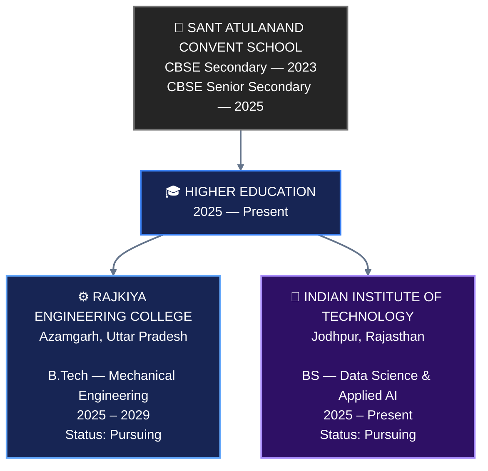

  

   

  
  
  
  

    

  

  <h3>Building. Experimenting. Learning. Shipping.</h3>

  
<i>Building intelligent systems and turning ideas into real-world products.</i>

<!-- ABOUT ME + DEVELOPER PROFILE: ONE UNIFIED BOX -->

<h2>01. About Me</h2>

<table width="100%" border="1" cellpadding="14" cellspacing="0">
<tr>
<td>

<table width="100%" border="0" cellpadding="8" cellspacing="0">
<tr>

<td width="65%" valign="top">

<h3>Hey! I'm Aryan Vishwakarma 👋</h3>

I'm a <b>Student Developer</b> interested in building practical products at the intersection of Artificial Intelligence, Data Science, and Software Engineering.

<b>Currently pursuing:</b>

<ul>
<li>B.Tech in Mechanical Engineering — Rajkiya Engineering College, Azamgarh.</li>
<li>BS in Data Science &amp; Applied AI — IIT Jodhpur.</li>
</ul>

I enjoy experimenting with AI, developing full-stack applications, exploring datasets, solving programming problems, and collaborating with developer communities.

<h3>⚡ Developer Profile</h3>

<b>Name:</b> Aryan Vishwakarma

<b>Alias:</b> AVX

<b>Role:</b> Student Developer

<b>Areas of Interest</b>

Artificial Intelligence · Machine Learning · Generative AI · Data Science · Full Stack Development · Open Source

<b>Currently Learning</b>

Data Structures &amp; Algorithms · Machine Learning · Generative AI · Backend Engineering

<b>Currently Building</b>

INIT — The Builder Network · AI-powered Developer Tools · Data-driven Applications

<b>Goal:</b> Build useful technology and ship real products.

</td>

<td width="35%" align="center" valign="middle">

  

<h2>AVX</h2>

<b>Build. Experiment. Ship.</b>

  

</td>

</tr>
</table>

</td>
</tr>
</table>

<!-- TECH STACK -->

<h2>02. Technical Arsenal</h2>

<h3>Programming Languages</h3>

<h3>AI, Machine Learning &amp; Data Science</h3>

<h3>Web Development</h3>

<h3>Databases &amp; Developer Tools</h3>

<h3>Data Analytics &amp; Engineering</h3>

<!-- FEATURED PROJECTS -->

<h2>03. Featured Projects</h2>

<h3>01 — Mansik Santulan</h3>

An AI-powered emotional wellness platform designed to analyze user inputs, identify emotional patterns, and provide a structured way to monitor mood and wellbeing.

<ul>
<li>Sentiment analysis of user inputs.</li>
<li>Mood tracking and visualization.</li>
<li>Interactive user experience.</li>
<li>Focus on responsible handling of sensitive information.</li>
</ul>

<b>Technology:</b> React · Node.js · Python · Sentiment Analysis APIs

<b>Achievement:</b> 🥇 First Place — AI HackMatrix, Chandigarh University.

<h3>02 — NEURAL HUB // AVX</h3>

An AI-powered learning and developer assistant focused on simplifying complex programming concepts and helping developers explore technical topics.

<ul>
<li>AI-generated technical explanations.</li>
<li>Developer-focused learning experience.</li>
<li>Frontend and backend integration.</li>
</ul>

<b>Technology:</b> Python · Flask · JavaScript · AI APIs

<h3>03 — StreamFlow</h3>

A data engineering and ETL project focused on transforming inconsistent datasets into structured, analysis-ready information.

<ul>
<li>Data cleaning and preprocessing.</li>
<li>Missing-value handling.</li>
<li>Dataset transformation.</li>
<li>Preparation of data for analytics and machine learning workflows.</li>
</ul>

<b>Technology:</b> Python · Pandas · Jupyter Notebook

<h3>04 — INIT: The Builder Network</h3>

<h3 align="center">Start. Build. Ship.</h3>

INIT is a builder-focused community initiative designed to connect learners, developers, and creators through teams, projects, collaborative labs, events, and practical building experiences.

<ul>
<li>Project-based collaboration.</li>
<li>Developer community building.</li>
<li>Hackathons and technical events.</li>
<li>Building an ecosystem for student innovators.</li>
</ul>

<b>Focus:</b> Community Building · Product Development · Developer Ecosystem

<!-- ADDITIONAL PROJECTS -->

<h2>04. Additional Projects</h2>

<table width="100%">
<thead>
<tr>
<th align="left">Project</th>
<th align="left">Description</th>
<th align="left">Technology</th>
</tr>
</thead>

<tbody>
<tr>
<td><b>Fruit Classification</b></td>
<td>Classification using fruit attributes.</td>
<td>WEKA</td>
</tr>
<tr>
<td><b>NLP Chatbot</b></td>
<td>Rule-based conversational system.</td>
<td>Python, NLP</td>
</tr>
<tr>
<td><b>E-Commerce Analytics</b></td>
<td>Sales and purchasing-pattern analysis.</td>
<td>KNIME, Python</td>
</tr>
<tr>
<td><b>SQL Analysis</b></td>
<td>Relational database analytics.</td>
<td>MySQL</td>
</tr>
<tr>
<td><b>Python Practice</b></td>
<td>Structured programming exercises.</td>
<td>Python</td>
</tr>
<tr>
<td><b>Web Development</b></td>
<td>Frontend experiments and applications.</td>
<td>HTML, CSS, JavaScript</td>
</tr>
</tbody>
</table>

 

<!-- ACHIEVEMENTS -->

<h2>05. Communities &amp; Achievements</h2>

<h3>Communities</h3>

<h4>INIT — The Builder Network</h4>

Working on a builder-focused ecosystem for student developers, project teams, open-source participation, and collaborative learning.

<h4>AWS Student Builder Group — IIT Jodhpur</h4>

Contributing to technology and social media activities within the student builder community.

<h3>Achievements &amp; Activities</h3>

<table width="100%">
<thead>
<tr>
<th align="left">Event / Activity</th>
<th align="left">Recognition</th>
</tr>
</thead>
<tbody>
<tr>
<td>AI HackMatrix — Chandigarh University</td>
<td>🥇 First Place</td>
</tr>
<tr>
<td>INIT X HackDay × Hacktoberfest 2026</td>
<td>Developer community event initiative</td>
</tr>
<tr>
<td>Open Source &amp; Developer Communities</td>
<td>Ongoing participation</td>
</tr>
</tbody>
</table>

<!-- EDUCATION -->

<h2 align="center">06. Education Journey</h2>

  <i>One academic foundation. Two parallel learning paths.</i>

<!-- GITHUB ANALYTICS -->

<h2>07. GitHub Analytics</h2>

  

<!-- LEETCODE -->

<h2>08. LeetCode Statistics</h2>

  

<!-- CURRENT GOALS -->

<h2>09. What's Next?</h2>

<ul>
<li>Strengthening Data Structures &amp; Algorithms.</li>
<li>Building practical AI and Machine Learning applications.</li>
<li>Exploring Generative AI and intelligent agents.</li>
<li>Contributing to open-source projects.</li>
<li>Developing products that solve real-world problems.</li>
</ul>

<b>Open to:</b> Internships · Collaborations · Hackathons · Open Source

<!-- CONTACT -->

<h2>10. Let's Connect</h2>

Interested in technology, AI, open source, or building something together?

  

<h3>Building the future, one commit at a time.</h3>

<i>"Ideas are easy. Building, testing, and shipping them is the real work."</i>

 

